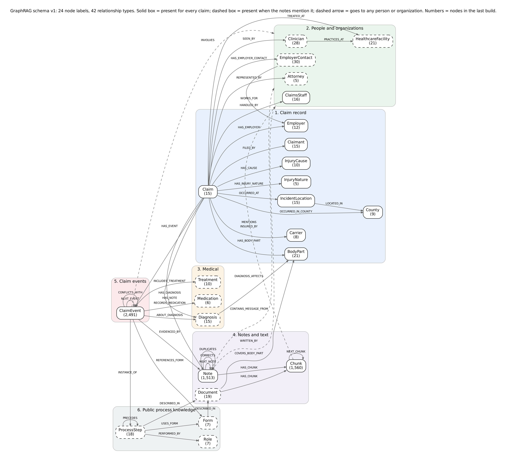

# GraphRAG graph schema v1: Gallagher Bassett claims capstone (IDS 560, Group 3)

**Owner:** Keya Debnath (graph schema) · **Date:** October 21, 2026 · **Schema version:** 1.0.0 · **Status:** tested on the 15-claim note set; relationships extracted from note text still need a human audit (see section 7).

This folder defines what the GraphRAG knowledge graph contains (the **schema**), and includes code that builds the graph from the 15 claims and their 1,513 notes, checks every node and relationship against the schema, and runs 15 test questions on it.

**Result of the last build:** 5,856 nodes, 23,326 relationships, 2,491 claim events, **0 schema violations**. 1,509 of 1,513 notes (99.7%) produced at least one event. All 15 test questions ran as Cypher in an embedded graph database and returned the answers found by reading the notes.

---

## 1. The schema in one picture



**24 node labels and 42 relationship types in 6 layers.** Solid boxes exist for every claim; dashed boxes exist when the notes mention them.

| Layer | Node labels | What it holds |
|---|---|---|
| 1. Claim record | Claim, Claimant, Employer, Carrier, County, IncidentLocation, InjuryNature, BodyPart, InjuryCause | One value per claim, from the structured columns |
| 2. People and organizations | ClaimsStaff, EmployerContact, HealthcareFacility, Clinician, Attorney | Everyone named in note headers and note text |
| 3. Medical | Diagnosis, Treatment, Medication | What the notes say about the injury and care |
| 4. Notes and text | Note, Chunk, Document | The text itself; Chunk is what retrieval returns and cites |
| 5. Claim events | ClaimEvent (47 event types) | What happened, when, who was involved, and which notes say so |
| 6. Public process knowledge | ProcessStep, Form, Role | NY Workers' Compensation Board rules, quoted from public WCB pages |

Full definitions: `01_schema/02_entity_definitions.csv` (one row per entity) and `01_schema/03_relationship_definitions.csv` (one row per relationship).

---

## 2. Folder map

```
graph_schema_v1/
├── README.md                          this file
├── requirements.txt                   Python packages
├── .gitignore                         keeps raw data and the evaluation answer key out of git
├── 01_schema/                         WHAT the graph contains (read these first)
├── 02_reference_data/                 curated lists the builder uses (forms, process steps, documents, glossary)
├── 03_code/                           scripts, numbered in the order you run them
├── 04_neo4j/                          files to create and load the graph in Neo4j
├── 05_outputs/                        everything the scripts produce (graph, reports, test answers)
└── data/                              NOT in git: put the notes CSV and downloaded documents here
```

---

## 3. Every file, explained

### 01_schema/ (the schema itself)

| File | What is inside | Who needs it |
|---|---|---|
| `01_graph_schema_definition_v1.yaml` | **The single source of truth.** Every node label (key, properties, layer, required or optional), every relationship type (allowed from and to labels, meaning), the provenance fields every relationship carries, and the facts that must have one value per claim. The builder rejects anything not listed here. | Anyone changing the schema; the extraction team |
| `02_entity_definitions.csv` | One row per node label: what it is, its key, an example key, its properties, where the data comes from, required or not, and the count in the last build. Generated from the YAML. | Team, TA, professor (easiest to read) |
| `03_relationship_definitions.csv` | One row per relationship type and (from, to) pair: meaning, how it is created, count in the last build. Generated from the YAML. | Team, TA, professor |
| `04_claim_event_types.csv` | The 47 kinds of `ClaimEvent` (e.g. `hearing_held`, `bill_review`, `work_status_update`): definition, the attributes each one carries, an example phrase from the notes, and the WCB process step it is an instance of. | Extraction team (LLM or System 1 must output these types) |
| `05_schema_diagram.png` / `.svg` / `.dot` | The diagram above. `.dot` is the Graphviz source. Generated from the YAML. | Slides, report |
| `06_schema_coverage_checklist.md` | Every kind of fact found in the notes, with an example, and where it lives in the schema (node, relationship or property), plus what is deliberately not modeled and why. **This answers the sponsor's request not to miss any entity or relationship.** | Sponsor, TA |
| `07_changes_from_v0_and_midterm.md` | What changed from v0 (Oct 6) and the midterm version (Oct 12), and why. | Anyone who saw the earlier versions |

### 02_reference_data/ (curated inputs; edit these, not the code)

| File | What is inside |
|---|---|
| `01_abbreviation_glossary.csv` | Shorthand used in the notes and what it means in the graph (cx, clmt, EE, IW = claimant; ER = employer; SIF = State Insurance Fund; DOI, restr, RTW, HEP, NCM, IME, MMI...). |
| `02_body_part_to_treatment_guideline_map.csv` | Which NY Medical Treatment Guideline covers each body part named in the notes. Status `draft` or `uncertain`; needs team review. |
| `03_wcb_forms.csv` | The 7 WCB forms that appear in the notes (C-3, C-2F, C-4.2, C-7, C-257, MG-2, RFA-1): title, who files it, purpose, source document. |
| `04_claims_process_steps.csv` | 18 steps of the NY claims process, each with a **verbatim quote** from a public WCB page, deadline, responsible role, forms, and order. Quotes were captured through a web reader and must be checked against the downloaded files (column `quote_check_status`). |
| `05_process_roles.csv` | 7 generic roles (claimant, employer, insurer, health care provider, Board, law judge, claimant attorney) and which node labels play each role. |
| `06_reference_documents_manifest.csv` | The 19 public documents for the GraphRAG corpus (WCB pages, fact sheets, form PDFs, 6 Medical Treatment Guidelines): ID, title, URL, local file name, redistribution status, and why each is included. |
| `07_healthcare_facilities_seed.csv` | Names and spelling variants of the PT clinics, imaging centers and pharmacies in the notes (treating clinics come from the notes file itself). |
| `08_treatments_and_medications_seed.csv` | Treatments and medications to recognize, with the text patterns used. |

### 03_code/ (run in number order)

| File | What it does | Writes |
|---|---|---|
| `00_make_schema_tables_and_diagram.py` | Turns the YAML into the two definition CSVs and the diagram (adds counts if a build exists). | `01_schema/02_*`, `03_*`, `05_*` |
| `01_download_reference_documents.py` | Downloads the 19 public documents in the manifest. Needs internet. `--skip-internal-only` leaves out the treatment guidelines. | `data/reference_docs/` |
| `02_build_graph_from_claim_notes.py` | **The main script.** Reads the notes CSV, builds all 6 layers, extracts events from note text with rules, detects conflicts, splits notes and downloaded documents into chunks, validates against the YAML, and writes all outputs. Refuses to read the evaluation answer key. Optional `--ny-claims` adds WCIO codes and record fields from the NY public file. | `05_outputs/01_*` to `06_*`, `08_*`; `04_neo4j/02_*` |
| `03_run_schema_test_questions.py` | Loads the built graph into Kuzu (an embedded database that runs Cypher, no server needed), runs the 15 test questions, and writes question, Cypher, real result, reference answer and evidence. | `05_outputs/07_*`; `04_neo4j/03_*` |
| `lib_text_normalization.py` | Shared helpers: reads dates written in 6+ formats ("09DEC25", "12-9-2025", "Dec 9"), normalizes names ("&"/"and", "Occ"/"Occupational"), fuzzy matching for misspellings. | |
| `run_all.sh` | Runs 01, 02, 00, 03 in the right order. | |

### 04_neo4j/

| File | What it does |
|---|---|
| `01_create_constraints_and_indexes.cypher` | Run first on an empty Neo4j 5 database: one uniqueness constraint per label, full-text indexes for passage search and name/alias lookup, and a commented-out vector index for chunk embeddings. |
| `02_load_graph_generated.cypher` | Generated. Loads every node and relationship with `MERGE`, so running it twice does not duplicate anything. About 12 MB; for Neo4j Desktop use `:source` or `cypher-shell -f`. |
| `03_schema_test_queries.cypher` | Generated. The 15 test queries, ready to paste into Neo4j Browser. |

### 05_outputs/ (all generated; re-run the scripts to refresh)

| File | What is inside |
|---|---|
| `01_graph_build_report.md` | **Start here.** Counts by label, relationship and event type; review status; coverage by note type; every data problem found (wrong claim numbers in emails, ambiguous names, misspelled names, cut-off notes, conflicts). |
| `02_graph_nodes_all.csv` | Every node: id, label, key, all properties as JSON. |
| `03_graph_relationships_all.csv` | Every relationship: type, from, to, provenance (source type, source note IDs, method, review status, schema version, claim scope) and properties as JSON. |
| `04_claim_events_timeline.csv` | One row per event, sorted by claim and date: type, summary, support (primary / summary_only / restated_only), supporting note IDs, attributes. The easiest way to see what a claim's history looks like in the graph. |
| `05_conflicts_found.csv` | 50 places where the notes disagree with themselves (dates of injury, return-to-work dates, hearing outcomes, IME report dated before the exam, paid-to-date going down), with the notes on each side and whether a correction note resolves it. Useful for the conflicting-question part of the evaluation. |
| `06_unmapped_notes_for_review.csv` | The 4 notes that produced no event, for a human to check. |
| `07_schema_test_questions_and_answers.md` | The 15 test questions with Cypher, real results and reference answers. **Keep out of both retrieval indexes.** |
| `08_graph_for_ui_without_chunks.json` | Nodes and links (no passage text) for the Streamlit graph view. |

---

## 4. How to run

```bash
pip install -r requirements.txt
# 1. Put the notes file here (from the team Box folder claim_notes_v2_15):
#      data/claim_notes/GB_15claims_Pack_Notes.csv
#    Do NOT copy pack_notes_answer_key.csv into this folder; it is for the evaluation team only.
# 2. Run everything:
bash 03_code/run_all.sh
# or step by step:
python 03_code/01_download_reference_documents.py          # needs internet; optional
python 03_code/02_build_graph_from_claim_notes.py           # about 10 seconds
python 03_code/00_make_schema_tables_and_diagram.py
python 03_code/03_run_schema_test_questions.py
```

Optional: `python 03_code/02_build_graph_from_claim_notes.py --ny-claims data/Assembled_Workers__Compensation_Claims.csv` fills WCIO codes, carrier type, claim injury type, highest process, district, industry and the record accident date, and reports any record accident date that differs from the notes. This option was tested with a small mock file only, because the 76 MB NY file was not available in this build.

## 5. How to load into Neo4j

1. Create an empty Neo4j 5 database.
2. Run `04_neo4j/01_create_constraints_and_indexes.cypher`.
3. Run `04_neo4j/02_load_graph_generated.cypher` (`cypher-shell -u neo4j -p <password> -f 04_neo4j/02_load_graph_generated.cypher`).
4. Check counts: `MATCH (n) RETURN count(n)` should be 5,856 and `MATCH ()-[r]->() RETURN count(r)` should be 23,326.
5. Try the queries in `04_neo4j/03_schema_test_queries.cypher`.

The two `.cypher` files have **not been run on a Neo4j server** (none was available where this was built). The same graph and the same test queries were run in Kuzu, which uses Cypher, and loaded exactly (5,856 nodes, 23,326 relationships). Please report any Neo4j error to Keya.

---

## 6. Design rules

1. **Fixed list.** Only the labels and relationship types in the YAML may be created. Extraction output that does not fit is rejected and logged, so the graph cannot grow without control.
2. **Node or property?** Something is a node only if several claims share it or we need to traverse through it (which other claims did this clinic treat? which guideline covers this body part?). Everything else is a property.
3. **Keys are IDs, never names.** Names repeat: Maya Patel is both a claimant and an adjuster; "Dr Fischer" treats on two claims and does an IME on a third; Carla Brennan is a supervisor on one claim and an attorney on another. People are keyed by name plus organization and role.
4. **Provenance on every relationship:** source type, source note IDs, method, review status, schema version, claim scope.
5. **Facts stay inside their claim.** Text is matched only against the people and organizations of that note's own claim. Mentions that could be two people are logged, not guessed.
6. **Never overwrite a disagreement.** Two different values for a fact that should have one value become two events linked by `CONFLICTS_WITH`. A correction note marks the wrong one.
7. **First-hand versus copied.** Evidence is tagged `primary`, `summary` or `restated` (copied history). An event supported only by copied text is `restated_only`.
8. **Every event cites its notes.** `EVIDENCED_BY` stores the note, the chunk, the character positions and the exact quote.
9. **A missing value creates no edge.** No "UNKNOWN" nodes.

---

## 7. What is verified and what is not

| Verified | Not yet verified |
|---|---|
| 0 schema violations; all required claim-record links present for all 15 claims | Extraction accuracy has not been measured on a hand-labeled sample. The 13,710 text-extracted relationships are `unreviewed`. Suggested audit: 50 random events against their notes |
| 99.7% of notes produce an event | Neo4j load not run on a server (Kuzu load is exact) |
| Full event timeline of claim 6977160 checked against all its notes by hand; legal and medical events of 6977163, 6977156, 6977197 and 6977137 spot-checked | The 18 process-step quotes were captured through a web reader; check each against the downloaded page |
| 15 test questions run as Cypher; reference answers written from the notes | Body-part-to-guideline map is a draft (`uncertain` rows need clinical review) |
| Reference-document chunking tested with a stand-in HTML page and PDF | Documents not downloaded here (no internet access from the build environment); run script 01 |

The extraction here is **rule-based** and written for this note set. It is the reference build that shows every fact fits the schema. The team's LLM or System 1 extractor should output the same labels, relationship types and event types; compare its output with `04_claim_events_timeline.csv`.

---

## 8. Problems found in the data (details in `05_outputs/01_graph_build_report.md`)

1. **The notes contradict themselves**, which is good for testing: 50 conflicts, e.g. two outcomes for the same hearing on claims 6977156, 6977163 and 6977197 ("decision received" versus "judge reserved decision") and for the conciliation on 6977098 and 6977100 ("no agreement" versus "issue narrowed"); two return-to-full-duty dates on 6 claims; IME report dated before the exam on 6977156 and 6977197.
2. **Copied history invents events.** "Second hearing April 11" on 6977160 appears only in copied summaries; no legal note records it.
3. **Claimant equals adjuster** on 6977140 (Maya Patel) and 6977144 (Priya Shah). Mentions of those full names cannot be resolved and are not linked.
4. **11 pasted emails carry the wrong claim number** in the subject line (e.g. 6977136 on claim 6977163).
5. **Carrier does not match employer** on 4 claims: the public record's carrier is a self-insured company (Wegmans, Starbucks, "Police, Fire, Sanitation") but the synthetic employer is a different company.
6. **IME fees look wrong:** $8,500 to $22,000, the same figures used for reserves.
7. **Date of injury in 2015** on 6977163 (noise exposure, late-reported), which the generator README says is intentional.

## 9. Information still needed

1. **Neo4j:** who on the team runs the load, and which Neo4j version (5.x assumed).
2. **Extraction approach:** LLM or System 1 for the final build, so the event types in `04_claim_event_types.csv` can be turned into its output format.
3. **Claim tiers:** the sponsor mentioned tiers; the notes file has no tier field. If the team defines them, they become a `Claim.tier` property.
4. **Review owners:** who checks the 18 process-step quotes and the body-part-to-guideline map.
5. **NY public file:** to fill WCIO codes, run step 02 with `--ny-claims`.
6. **Notes 001 to 003:** note IDs start at 004 in this file. The 15 claims are a subset of the 34 in GB_102_Synthetic_Notes.csv (3 notes per claim), so 001 to 003 are probably those earlier notes. Confirm whether they belong in the corpus.

## 10. Data handling

- `data/` is not committed. The notes CSV comes from the team Box folder. The outputs contain note text, so keep the repository private.
- The six Medical Treatment Guideline PDFs are for internal reference; they are never committed.
- `pack_notes_answer_key.csv` is for the evaluation team only. The builder refuses to read it, and `.gitignore` blocks it.
- `05_outputs/07_schema_test_questions_and_answers.md` contains reference answers: keep it out of both retrieval indexes.

## 11. Change log

| Version | Date | Change |
|---|---|---|
| 0.1.0 | 2026-10-06 | v0, demo data (34 claims, 102 notes) |
| midterm | 2026-10-12 | 17 entities, 26 relationships, event layer introduced (slides only) |
| 1.0.0 | 2026-10-21 | v1: 24 labels, 42 relationships, 47 event types, built and tested on 15 claims / 1,513 notes |
